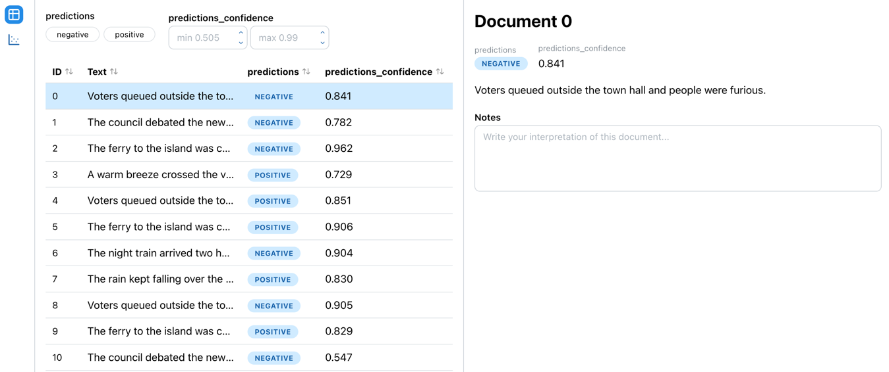

# sourcetext

[](https://pypi.org/project/sourcetext/)
[](https://github.com/KasperFyhn/sourcetext/actions/workflows/ci.yml)
[](https://github.com/KasperFyhn/sourcetext/blob/main/LICENSE)

**Return to the source text behind your model output, and write down what you find.**

Sometimes, working with and understanding a text corpus requires more than your NLP models' output. It requires close reading of the source text: looking at the documents behind a prediction, a cluster, or an
outlier score, and recording your interpretation as you go.

sourcetext gives you that in three lines of Python code. Hand it your texts and
your model's output (labels, scores, clusters, embeddings, dates), and it opens a
local web app where you can browse, sort, filter and plot the documents, read each
one in full, and attach notes to it.

```bash
pip install sourcetext
```

## Quickstart

```python
from sourcetext import SourceText

texts = [
    "The harvest failed for the third year running.",
    "A new bridge was opened to great celebration.",
    "Grain prices rose sharply in the spring.",
]
predictions = ["negative", "positive", "negative"]

st = SourceText(texts, prediction=predictions)
st.start_server()  # then open http://localhost:8001
```

And dive into the source text in a simple UI in your browser.



In a script, `start_server()` blocks until you press Ctrl+C. In Jupyter it runs in
the background, so you can keep working and call `st.stop_server()` when done.

## What you get

- **Table view.** Every document with its fields as columns. Sort by any column,
  and filter by label, score range or date range.
- **Plot view.** Plot documents by a 2D embedding projection (e.g. UMAP), or put
  any two fields on the axes, optionally coloured by a label. Two scores
  give a scatter plot, useful for spotting where a model's confidence and a second
  measure disagree. A score against a label gives a strip plot: one row
  (or column) per category, with every document as its own dot.
- **Confusion matrix view.** Cross two label fields (e.g. gold labels and
  predictions) and click a cell to list its documents, which you can then filter
  further by their other fields.
- **Document pane.** Select a document in any view to read its full text
  alongside all of its field values.
- **Notes.** Write a free-text note on any document while you read it. Notes are
  saved to a plain JSONL file you choose, so they survive between sessions.

## Examples

### Classification with gold labels and confidence

```python
from transformers import pipeline
from sourcetext import SourceText

classify = pipeline("sentiment-analysis")
outputs = classify(texts)

st = SourceText(
    texts,
    prediction=[o["label"] for o in outputs],
    confidence=[o["score"] for o in outputs],
    gold_label=gold_labels,
)
st.start_server()
```

Sort by confidence to read the model's most and least certain calls. The confusion
matrix view opens on gold labels vs. predictions: click an off-diagonal cell to read
the documents the model got wrong. The plot view opens on confidence per gold label,
coloured by prediction, so you can see whether those errors were confident or only
borderline.

### Topic model with group definitions

```python
from bertopic import BERTopic
from sourcetext import ScoreType, SourceText

topic_model = BERTopic()
topics, probs = topic_model.fit_transform(texts)
keywords = {t: ", ".join(w for w, _ in topic_model.get_topic(t)) for t in set(topics)}

st = SourceText(
    texts,
    group=topics,
    group_definitions=keywords,
    topic_probability=ScoreType(probs),
)
st.start_server()
```

Filter to one topic and sort by `topic_probability` to see its most and least typical
documents.

### Document embeddings on a map

```python
from sentence_transformers import SentenceTransformer
from sklearn.cluster import KMeans
from umap import UMAP
from sourcetext import SourceText

embeddings = SentenceTransformer("all-MiniLM-L6-v2").encode(texts)
clusters = KMeans(n_clusters=8).fit_predict(embeddings)
xy = UMAP().fit_transform(embeddings)

st = SourceText(
    texts,
    group=clusters,
    embedding=xy,
)
st.start_server()
```

In the plot view, pick `embedding` and colour by `group` to see which clusters
the projection keeps together, then click through the points where it doesn't.

### From a DataFrame, with metadata

```python
from sourcetext import SourceText, TemporalType, TextType

# df has columns: id, text, title, year, prediction, gold
st = SourceText(
    data=df,
    text="text",
    doc_id="id",
    prediction="prediction",
    gold_label="gold",
    title=TextType("title"),
    year=TemporalType("year"),
)
st.start_server()
```

## Project status

sourcetext is in early development (alpha). The API may change between releases,
and some parts are not built yet:

- **Spans** (`SpanType`, e.g. NER output) are accepted and stored, but not yet
  highlighted in the text.

See the [roadmap](https://github.com/KasperFyhn/sourcetext/blob/main/ROADMAP.md) for
what's planned next.

Feedback and issues are very welcome at
[github.com/KasperFyhn/sourcetext/issues](https://github.com/KasperFyhn/sourcetext/issues).

---

# Documentation

## `SourceText`

```python
SourceText(
    text,
    *,
    data=None,
    doc_id=None,
    prediction=None,
    confidence=None,
    gold_label=None,
    score=None,
    embedding=None,
    group=None,
    group_definitions=None,
    notes_file=None,
    **fields,
)
```

`text` is the only required argument. Everything else attaches a **field** to the
documents: one value per document, shown as a column in the table and as a row in
the document pane.

### Two ways to pass data

Every argument takes either **an array of values** (one per text, in the same
order: a list, numpy array or pandas Series), or, when `data=` is given, **the name
of a column** in that DataFrame. Pick one mode per call:

```python
# Lists
SourceText(texts, prediction=preds)

# DataFrame columns
SourceText(data=df, text="text", prediction="pred")
```

Missing values can be given as `None`, and pandas' `NaN`/`NaT`/`pd.NA` are treated
the same way. Numpy and pandas values (e.g. `np.float32` scores, `np.datetime64`
dates) are converted to their plain Python equivalents.

### Document IDs

By default documents are numbered `0, 1, 2, …`. Pass `doc_id=` (ints or strings) to
use your own, e.g. to match document IDs elsewhere in your pipeline.

### Named fields

These cover the common cases, and need no wrapping:

| Argument            | Field type    | For                                            |
|---------------------|---------------|------------------------------------------------|
| `prediction`        | `LabelType`   | a classifier's predicted labels                |
| `confidence`        | `ScoreType`   | the classifier's confidence in each prediction |
| `gold_label`        | `LabelType`   | reference / ground-truth labels                |
| `score`             | `ScoreType`   | any single numeric score, e.g. sentiment       |
| `embedding`         | `Point2DType` | a 2D projection of document embeddings         |
| `group`             | `LabelType`   | cluster or topic assignments                   |
| `group_definitions` | —             | what each group means (see below)              |

### Custom fields

Any other keyword argument adds a field with that name. Wrap its values (or its
column name) in a field type, so sourcetext knows how to store, display and filter
it:

```python
from sourcetext import ScoreType, LabelType

SourceText(
    texts,
    toxicity=ScoreType(toxicity_scores),
    genre=LabelType("genre"),  # column name, with data=
)
```

## Field types

| Type           | Values                                               | In the app                                                    | Typical use                            |
|----------------|------------------------------------------------------|---------------------------------------------------------------|----------------------------------------|
| `TextType`     | `str`                                                | shown as text                                                 | titles, authors, source metadata       |
| `LabelType`    | `str`, `int`, `bool`                                 | badge; filter by value; plot axis or colour; confusion matrix | classes, gold labels, clusters, topics |
| `ScoreType`    | `float`, `int`                                       | filter by range; plot axis                                    | confidence, sentiment, any metric      |
| `TemporalType` | `int` (a year), `datetime.date`, `datetime.datetime` | filter by range                                               | publication year, timestamps           |
| `Point2DType`  | `(x, y)` pair of numbers                             | position in the plot                                          | UMAP / t-SNE embedding projections     |
| `SpanType`     | list of `{"start", "end", "label"}` dicts            | *not yet displayed*                                           | named entities, marked passages        |

All columns in the table view are sortable.

Notes on specific types:

- **`TemporalType`**: all values in one field must share a type. Plain ints are
  treated as years.
- **`SpanType`**: each document gets a list of spans (possibly empty). `start` and
  `end` are character offsets into the text, `label` is a string, and an optional
  `score` may be included.
- **`Point2DType`**: to plot two separate scores against each other instead, just
  pass them as two `ScoreType` fields and pick both as axes in the plot view.

### Label definitions

`LabelType` accepts a `definitions=` dict mapping each value to what it means: a
codebook entry for an annotation category, or a topic's keywords. That can be a
plain string, or any JSON-serializable object (e.g. keywords with weights).
`group_definitions=` is shorthand for attaching one to `group=`:

```python
# These are equivalent:
SourceText(texts, group=topics, group_definitions=keywords)
SourceText(texts, group=LabelType(topics, definitions=keywords))

# Other label fields take definitions= directly, e.g. a codebook:
SourceText(
    texts,
    gold_label=LabelType(gold, definitions={"irony": "Says the opposite of what is meant"}),
    era=LabelType(eras, definitions={"early": "before 1850", "late": "1850 and after"}),
)
```

In the app, a value with a definition is marked with an ⓘ wherever it appears
(badges, filter options, plot legends and axes, confusion matrix headers): hover
the ⓘ to see the definition.
Keyword lists, as `[word, weight]` pairs or a `{word: weight}` dict, are shown as
a table of words and weights.

## Notes

Notes you write in the app are saved to a JSONL file. Pass its path as
`notes_file=` to load the notes in it when the `SourceText` is created:

```python
st = SourceText(texts, prediction=preds, notes_file="notes.jsonl")
```

The file doesn't need to exist yet; it is created when the first note is written.

Notes are always saved to a file; they're never kept only in memory. Without
`notes_file=`, sourcetext looks for `sourcetext_notes.jsonl` in your working
directory and uses it if it's there. This is the app's suggested file, so notes
saved there come back when you run the same code again. Otherwise the notes field
is disabled until you click **Select notes file ...** next to it: pick a new file,
or the file you saved notes to before to continue with them (relative paths are
relative to your Python session's working directory). Once chosen, the file's name
is shown there instead; click it to switch to another file.

If you switch to a file that has a different note on a document than the one
you're already using, neither note is lost: both are kept in one note, the older first, separated by
`---`.

Each line of the file is one note:

```json
{"document_id": "42", "text_hash": "3f2a9c1e0b7d4e85", "note": "Sarcasm, not praise.", "updated_at": "2026-10-13T12:00:00+00:00"}
```

Read it back into pandas with `pd.read_json("notes.jsonl", lines=True)`.

Notes are matched back to documents like this:

- **With `doc_id=`**: by document ID. You're warned if a document's text has changed
  since its note was written.
- **Without `doc_id=`**: by the text itself (`text_hash`), since the default IDs are
  just row positions and change when the data is reordered or filtered. If several
  documents have exactly the same text, the note is shown on all of them.

Notes for documents that aren't in the current corpus (e.g. when you load a
subset) are kept in the file, not deleted. You're told how many there are.

## Serving the app

```python
st.start_server(port=8001, block=None)
st.stop_server()
```

- `port`: where the app is served, at `http://localhost:<port>`.
- `block`: `True` blocks until Ctrl+C (for scripts). `False` runs the server in
  the background (for Jupyter and other running event loops). The default `None`
  picks the right one automatically.

## Contributing

Development setup, the architecture, and how the Python package and the React
frontend fit together are described in
[CLAUDE.md](https://github.com/KasperFyhn/sourcetext/blob/main/CLAUDE.md). In short:

```bash
pip install -e ".[dev]"
pre-commit install
pytest
./scripts/dev.sh classification_simple   # API + hot-reloading UI on a mock dataset
```

## License

MIT
